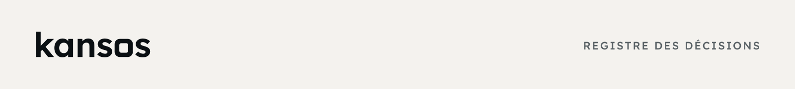

<picture>
  <source media="(prefers-color-scheme: dark)" srcset="assets/header-dark.png">
  
</picture>

# Registre des décisions techniques

Ce registre garde la trace du raisonnement derrière les décisions structurantes de KansOS, pas seulement leur résultat. Une décision dont on ne retrouve plus la raison se refait tous les six mois.

Toutes les décisions vivent ici, quel que soit le dépôt qu'elles concernent. Les dépôts de code renvoient vers ce registre depuis leur README.

| N° | Décision | Portée | Statut | Date |
|---|---|---|---|---|
| [0001](0001-backend-framework.md) | Langage et framework du backend : NestJS | backend |  | 2026-09-05 |
| [0002](0002-policy-engine.md) | Moteur de politique : fonction pure, sans moteur de règles | backend |  | 2026-09-05 |
| [0003](0003-show-dont-act.md) | Guidage : montrer sans agir | launcher |  | 2026-10-16 |
| [0004](0004-device-owner-adb.md) | Provisionnement : Device Owner posé via adb | launcher |  | 2026-10-16 |

## Statuts

| Statut | Signification |
|---|---|
|  | En relecture dans une PR. |
|  | Relu par une autre personne de l'équipe, puis fusionné. |
|  | Annulé par un ADR plus récent. On ne l'efface jamais. |

## Proposer une décision

1. Copier [`template.md`](template.md) en `00XX-sujet-court.md`, avec le numéro suivant et un nom de fichier en anglais.
2. Ouvrir une PR avec le statut « proposé ».
3. Une autre personne de l'équipe relit, commente et approuve.
4. Passer le statut à « accepté », ajouter la ligne dans le tableau ci-dessus, puis fusionner.

Quand une décision est remplacée, on change seulement son statut et on indique le nouvel ADR dans « Remplace ».

## Ce qui mérite un ADR

Une décision qui engage le projet : choix de technologie, découpage des composants, modèle de données, format d'échange, stratégie d'authentification, mode de déploiement, abandon d'un composant.

Ce qui n'en mérite pas : une convention de nommage, un choix d'outillage réversible en une heure, une évidence qu'aucune alternative sérieuse ne concurrençait.
