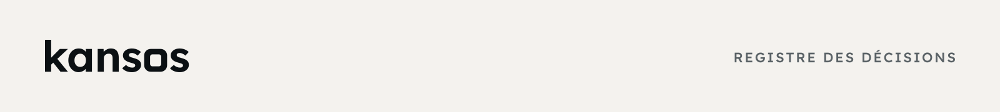

<picture>
  <source media="(prefers-color-scheme: dark)" srcset="assets/header-dark.png">
  
</picture>

# ADR 00XX · Sujet : décision en quelques mots

> **En une phrase.** Dans le contexte de …, face à …, nous avons choisi … plutôt que …, pour obtenir …, en acceptant ….

<table>
  <tr><td><b>Statut</b></td><td></td></tr>
  <tr><td><b>Date</b></td><td>AAAA-MM-JJ</td></tr>
  <tr><td><b>Décideurs</b></td><td></td></tr>
  <tr><td><b>Relu par</b></td><td></td></tr>
  <tr><td><b>Lié à</b></td><td></td></tr>
  <tr><td><b>Remplace</b></td><td></td></tr>
</table>

## Contexte

Le problème, la contrainte, et pourquoi il faut décider maintenant.

## Critères de décision

Ce qui compte pour trancher, posé avant de regarder les options : coût, accès, sécurité, délai…

## Options envisagées

Au moins deux, réellement pesées sur les critères.

**A. …**

- Avantages :
- Inconvénients :

**B. …**

- Avantages :
- Inconvénients :

## Décision

**Option X.** Pourquoi elle, et pourquoi pas les autres.

## Conséquences

### Positives

### Négatives

Ce que la décision coûte : dépendance, complexité, performance, dette.

### À surveiller

Le signal qui doit faire rouvrir cette décision.

## Réversibilité

**Bonne**, **moyenne** ou **faible**, et ce qu'il faudrait changer pour revenir en arrière.
