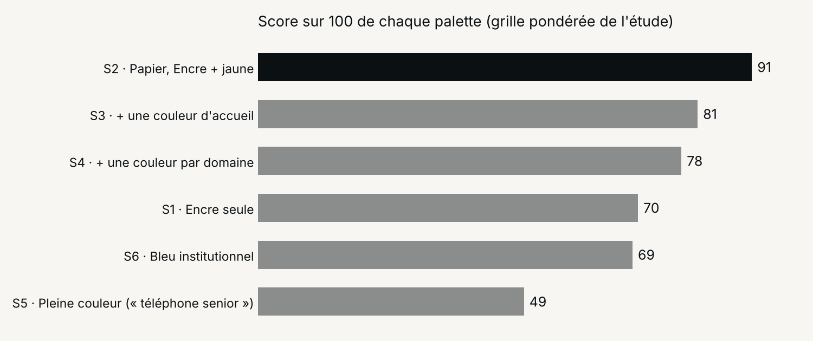

# Veille Dashboard : combien de couleurs ? Angel

Étude réalisée le 18 novembre 2026.

## En bref

**Réponse : trois couleurs d'identité, pas plus.** Deux neutres (Papier et Encre) et un seul signal (le jaune Guidage). Autour, une couche fonctionnelle de cinq tons sourds pour les états et les graphiques, jamais utilisée comme couleur de marque. Ce scénario obtient 91/100 sur la grille pondérée, contre 81 pour l'ajout d'une couleur d'accueil et 49 pour une palette pleine couleur façon « téléphone senior ».

La charte du 14 novembre a donc le bon squelette. L'étude recommande six changements, dont deux de fond :

1. **L'appareil passe en fond clair par défaut.** La recherche sur la polarité donne l'avantage au texte sombre sur fond clair à tout âge. Le fond sombre reste une option dans les réglages.
2. **Le cadre jaune devient « gainé » : encre, jaune, encre.** Il reste visible sur un fond clair et par-dessus Ameli, Doctolib ou France Identité, qui sont des applications claires. La règle « jamais de jaune sur fond clair » devient « jamais de jaune _seul_ sur fond clair ».
3. **Un cadre de guidage sans couleur est proposé en réglage**, pour les personnes que le jaune surcharge (hypersensibilité sensorielle).
4. **Les états gagnent deux tons : prune (attention) et brique (erreur)**, avec toujours une icône et un mot. L'orange reste interdit.
5. **Luciole devient la police de lecture proposée sur l'appareil**, à côté de Lexend. Lexend reste la police de la marque, du site, de la console et des diapos.
6. **Les cibles tactiles de l'appareil passent à 64 dp au moins**, et le texte secondaire à 7:1 de contraste (niveau AAA).

Le logo est conservé tel quel. Rien de tout cela ne remplace un test avec de vraies personnes accompagnées ; le protocole est en fin de document.

## Contexte, publics et contraintes

Une seule identité doit servir trois publics très différents, sur cinq surfaces. La personne accompagnée est la plus contrainte : c'est elle qui fixe le plancher.

| Public | Qui | Ce qui compte pour lui | Surfaces |
| --- | --- | --- | --- |
| Personne accompagnée | Adulte que le numérique met en difficulté : âge avancé, handicap intellectuel ou cognitif, basse vision, fatigue visuelle, hypersensibilité sensorielle | Lire sans effort, savoir où appuyer, ne jamais avoir deux choses à regarder, ne pas se sentir surveillée | Lanceur, overlay de guidage par-dessus les applications tierces |
| Aidant | Proche ou professionnel (mandataire, tuteur, éducateur) | Voir vite l'état des règles et des démarches, agir sans erreur, comprendre ce que voit la personne | Console web (kanso-web-dashboard) |
| Jury, partenaires, presse | Epitech, associations, structures médico-sociales, contributeurs open source | Comprendre le projet en une minute, lui faire confiance, le reconnaître | Site kansos.org, diapos, documents, GitHub |

Contraintes qui pèsent sur la couleur :

- **Le cadre de guidage est le produit.** Il doit être l'élément le plus visible de l'écran, dans n'importe quelle application, claire ou sombre.
- **Les applications guidées ne sont pas les nôtres.** Ameli, Doctolib, France Identité imposent leurs couleurs ; le cadre se pose par-dessus.
- **La relation aidant / personne est sensible.** L'identité ne doit évoquer ni le contrôle parental, ni l'hôpital, ni l'administration.
- **Niveau visé :** WCAG 2.2 AA et RGAA 4.1 partout ; AAA sur l'appareil.
- **L'équipe compte cinq personnes.** Chaque couleur ajoutée se maintient sur cinq dépôts et deux plateformes (web, Android).

## Ce que dit la recherche

Huit constats fondent les choix. Chacun est suivi de sa conséquence pour KansOS.

| Constat | Ce que montrent les sources | Conséquence pour KansOS |
| --- | --- | --- |
| Avec l'âge, le bleu et le jaune se confondent | Sur 865 adultes de 58 à 102 ans, la plupart des anomalies sont de type bleu-jaune, avec des confusions entre bleus et violets pâles et entre jaunes et verts ([Schneck, via News-Medical](https://www.news-medical.net/news/20140224/Study-reveals-that-color-vision-abnormalities-increase-with-age.aspx)). Le jaunissement du cristallin filtre les courtes longueurs d'onde ([PMC](https://pmc.ncbi.nlm.nih.gov/articles/PMC3648508)). | Le jaune ne se distingue jamais par sa teinte, seulement par sa luminance : jaune sur encre (11,4:1), jamais jaune sur papier (1,6:1). Pas de bleus pâles à distinguer entre eux. |
| Le daltonisme rouge-vert touche environ 8 % des hommes et 0,5 % des femmes | Même source. | Aucun état ne se lit à la couleur seule : couleur + icône + mot, toujours. |
| Texte sombre sur fond clair, à tout âge | La polarité positive l'emporte chez les jeunes comme chez les 60-85 ans, en acuité et en relecture ([Piepenbrock et al., Ergonomics](https://informahealthcare.com/doi/abs/10.1080/00140139.2013.790485)). L'avantage grandit quand le texte rétrécit ([NN/g](https://www.nngroup.com/articles/dark-mode/)). | Fond clair par défaut partout, appareil compris. Le sombre devient une option (éblouissement, photophobie). |
| Pas de blanc pur, pas de noir pur | Les guides dyslexie recommandent un texte sombre sur un fond clair mais pas blanc, pour limiter l'éblouissement ([BDA via Cardiff](https://blogs.cardiff.ac.uk/LTAcademy/not-just-pretty-colours-using-colour-and-contrast-inclusively)). | Papier #F7F6F2 et Encre #0B1013 sont confirmés : 17,7:1, sans blanc ni noir purs. |
| Le jaune attire, mais peut surcharger | Le jaune est perçu comme très lumineux et très visible. Mais des garçons autistes rejettent nettement le jaune, vécu comme surchargeant ([Grandgeorge & Masataka, Frontiers](https://pmc.ncbi.nlm.nih.gov/articles/PMC5179595)). Chez des conducteurs âgés, les icônes jaunes sont trouvées le plus lentement, surtout sur fond blanc ([IEEE Access](https://doaj.org/article/5d0d35e0ff314719aa636857a94531e0)). | Le jaune reste un trait fin et unique, jamais un aplat ni une icône. Un cadre sans couleur est proposé en réglage. |
| La couleur redondante accélère la recherche | La couleur ajoutée en double d'un autre indice réduit le temps de réponse quand elle est connue ([Sandvold et al.](https://oda.oslomet.no/oda-xmlui/handle/11250/3107666)). Chez les personnes âgées, avec ou sans trouble cognitif léger, icône + texte bat l'icône seule ([Wu et al., IJERPH](https://mdpi.com/1660-4601/19/8/4525/htm)). | Icône + mot partout. Couleurs de domaine possibles, mais seulement en indice secondaire et en tons sourds. |
| Familiarité et sobriété | Le W3C demande des icônes, termes et schémas déjà connus des personnes ([COGA](https://w3c.github.io/coga/content-usable/)). Alzheimer's Society conseille d'utiliser la couleur avec parcimonie ([Alzheimer's Society](https://www.alzheimers.org.uk/blog/how-design-websites-older-people)). | Peu de couleurs, chacune avec un seul sens. Liens soulignés, boutons en pilule, schémas Android standard. |
| Les grosses cibles sont plus sûres | Sur smartphone, la précision est maximale entre 42 et 72 px, et les personnes âgées préfèrent 72 px ([UX Movement](https://uxmovement.com/mobile/optimal-size-and-spacing-for-mobile-buttons/)). | 64 dp minimum sur l'appareil, 44 px sur le web. |

**Typographie.** Lexend vise la fluidité de lecture. Son appui le plus cité reste modeste : une étude sur 20 élèves de CE2, comparée à Times New Roman ([Lexend](https://lexend.com/)). Luciole a été conçue en France avec le CTRDV pour la basse vision, et évaluée en revue à comité de lecture ([Acta Psychologica](https://libmast.utm.my/Record/doaj.art-8e2e2e1ded0d43bb90049b5131547b56)). Elle est gratuite sous licence Creative Commons ([Fonts In Use](https://fontsinuse.com/typefaces/217546/luciole)). Les deux sont défendables ; les tests diront laquelle lire sur l'appareil.

**Rédaction.** Le FALC résulte de règles européennes portées par Inclusion Europe et diffusées en France par l'UNAPEI ([culture.gouv.fr](https://www.culture.gouv.fr/switchToLanguage/202725/fre-FR)). Ses règles de forme (police lisible, interlignage augmenté, alignement à gauche, pictogrammes) rejoignent celles ci-dessus.

## Benchmark

Les produits voisins confirment deux choses : la simplicité passe par peu d'éléments très gros, et personne ne possède un signal de guidage unique. C'est la place que KansOS peut prendre.

| Produit | Ce qu'il fait | Ce qu'on en retient |
| --- | --- | --- |
| [Apple Assistive Access](https://www.apple.com/au/accessibility/ipad/) | Interface pour le handicap cognitif, avec boutons très contrastés, grands libellés et alternatives visuelles au texte. Grille ou liste au choix ([Apple](https://support.apple.com/en-mz/guide/assistive-access-iphone/dev683243feb/ios)). Mode sombre en option ([Nerds Chalk](https://nerdschalk.com/?p=402019)). Grand bouton Retour toujours en bas. | Le mode simplifié de référence est neutre et laisse le choix de la polarité. KansOS doit offrir la même chose. |
| [Android TalkBack](https://qbalsdon.github.io/android/accessibility/talkback/2022/07/06/android_talkback.html) | Entoure l'élément sélectionné d'un cadre, souvent vert vif. La BBC juge ce cadre par défaut difficile à percevoir ([BBC](https://bbcstreaming.pages.dev/accessibility/forproducts/guides/mobile/visible-focus)). | Le « cadre autour de l'élément » est déjà un schéma Android connu (COGA : familiarité). KansOS l'adopte en plus épais, gainé et jaune, pour ne pas être confondu avec TalkBack. |
| Doro, Facilotab, Ordissimo | Surcouches et tablettes pour seniors : grandes icônes et grands textes ([Fnac](https://leclaireur.fnac.com/selection/cp66782-quelle-tablette-choisir-pour-une-personne-agee/)). Doro rapporte que 51 % des seniors ont peur de se tromper sur leur téléphone ([Leader Réunion](https://www.leaderreunion.fr/en/aurora-les-smartphones-ia-penses-pour-personnes-agees/)). | Ce marché est souvent très coloré et marqué « senior ». KansOS s'en distingue par la sobriété et vise un public plus large que l'âge. |
| [DSFR](https://www.info.gouv.fr/organisation/service-d-information-du-gouvernement-sig/systeme-de-design) | Système de design de l'État, bleu France et rouge Marianne, réservé aux sites en .gouv.fr ([DSFR](https://www.systeme-de-design.gouv.fr/version-courante/fr/composants)). Chaque couleur y existe en teinte claire et en teinte sombre pour tenir les contrastes dans les deux thèmes ([SIG](https://www.info.gouv.fr/accessibilite/charte-daccessibilite-de-la-communication-de-letat)). | KansOS ne doit pas ressembler à l'État : pas de bleu dominant. On reprend la méthode, une teinte claire et une sombre par couleur d'état. |

## Audit de la charte du 14 novembre

La charte est solide pour le site. Ses failles apparaissent sur l'appareil et dans la console, qu'elle ne couvrait pas encore.

**Ce qui tient, et pourquoi le garder**

- **Le logo.** Le « o » devenu cadre de guidage raconte le produit sans un mot. Il est géométrique, lisible à 16 px et déclinable en icône d'application. Aucune alternative ne fait mieux.
- **Une couleur, un sens.** Réserver le jaune au guidage applique exactement ce que demandent COGA et Alzheimer's Society : peu de couleurs, chacune avec un rôle fixe.
- **Papier et Encre.** Pas de blanc ni de noir purs, 17,7:1 de contraste : conforme aux guides dyslexie et au niveau AAA.
- **Lexend partout, Lucide au trait, icône + mot, focus à l'encre, mouvement désactivable.** Tout cela est conforme aux sources.

**Ce qui casse ou manque**

| Problème | Gravité | Pourquoi |
| --- | --- | --- |
| « Jamais de jaune sur fond clair » oblige l'appareil à être sombre | Haute | La recherche favorise le fond clair, y compris pour les personnes âgées. Et les apps guidées (Ameli, Doctolib) sont claires : le cadre jaune y disparaît. |
| Aucun réglage pour qui supporte mal le jaune | Moyenne | Des personnes hypersensibles vivent le jaune comme une surcharge. |
| Les états ne couvrent que les démarches (pris en charge, en test, prévu) | Moyenne | La console a besoin d'erreurs et d'avertissements, sans jaune ni orange. |
| Rien pour les graphiques | Moyenne | La console affiche des niveaux par domaine : il faut une palette de données. |
| Texte secondaire à 6,9:1 | Faible | Suffisant en AA, juste sous 7:1. L'appareil vise AAA. |
| Pas d'échelles console, appareil, diapos | Faible | Le texte courant du site (18-20 px) est trop gros pour un tableau et trop petit pour l'appareil. |

**Le risque d'image.** Une palette encre et blanc cassé peut paraître froide ou administrative. On le compense par le papier chaud, les formes arrondies, les vraies photos d'équipe et le ton des textes, pas par une couleur de plus.

## Scénarios : combien de couleurs ?

Six palettes ont été comparées sur sept critères pondérés. Le guidage pèse le plus lourd (25 %) parce que c'est le produit. Deux neutres et un signal (S2) arrivent en tête avec 10 points d'avance.

| Scénario | Guidage (25) | Lisibilité (15) | Charge cognitive (15) | Daltonisme et âge (15) | Chaleur (10) | Marque (10) | Faisabilité (10) |
| --- | --- | --- | --- | --- | --- | --- | --- |
| S2 Encre + signal : papier, encre, jaune | 5   | 5   | 5   | 4   | 3   | 4   | 5   |
| S3 + couleur d'accueil (un vert ou un brique pour la marque) | 4   | 5   | 4   | 4   | 4   | 4   | 3   |
| S4 + codage par domaine (4 teintes pour communication, démarches, médias, achats) | 4   | 5   | 4   | 3   | 4   | 4   | 3   |
| S1 Encre seule, guidage en encre épaisse | 2   | 5   | 5   | 4   | 2   | 2   | 5   |
| S6 Bleu institutionnel, façon services publics | 4   | 4   | 4   | 3   | 3   | 1   | 4   |
| S5 Pleine couleur, une couleur par app, façon téléphone senior | 2   | 3   | 2   | 2   | 4   | 2   | 3   |

**Pourquoi S2 gagne.** Le jaune est la seule teinte chaude et saturée de l'écran : il saute aux yeux sans concurrence. S1 perd ce signal ; S3 et S4 le diluent avec une seconde couleur forte ; S5 le noie.

**Ce que S3 et S4 apportent quand même.** Plus de chaleur, et un repère par domaine qui aide à retrouver une application. On garde cet apport sans perdre le signal : les teintes de domaine restent sourdes, réservées aux graphiques de la console, et toujours doublées d'une icône et d'un mot.

**Solidité du résultat.** Même en doublant le poids de la chaleur, S2 reste devant S3. Pour qu'il perde, il faudrait que la chaleur pèse au moins 35 points de plus que le guidage, ce qui contredit la mission du projet.

**Réponse.** Trois couleurs d'identité : deux neutres et un signal. Plus cinq tons fonctionnels sourds, qui ne sont jamais des couleurs de marque.

## Recommandation détaillée

On garde les quatre couleurs de la charte et on ajoute une couche fonctionnelle encadrée. Toutes les valeurs ont été vérifiées au calcul de contraste WCAG ; elles sont reprises à l'identique dans le design system.

**Identité : trois couleurs (plus Clair, leur inverse sur fond sombre)**

| Couleur | HEX | Rôle | Contraste |
| --- | --- | --- | --- |
| Papier | #F7F6F2 | Fond de tout, appareil compris | Encre dessus : 17,7:1 |
| Encre | #0B1013 | Texte, logo, boutons, focus, gaine du cadre | Sur papier : 17,7:1 |
| Clair | #E9ECEA | Texte et logo sur fond encre | Sur encre : 16,1:1 |
| Guidage | #F2C230 | Le cadre de guidage et le « o » du logo sur fond sombre. Rien d'autre | Sur encre : 11,4:1 ; sur papier : 1,6:1, d'où la gaine |

**Couche fonctionnelle : cinq tons sourds, jamais de marque**

| Ton | Sens | Fond / texte (clair) | Contraste |
| --- | --- | --- | --- |
| Vert | Pris en charge, actif, synchronisé | #DCEBE2 / #1B4A3A | 8,2:1 |
| Bleu | En test, en cours, information | #DDE5F1 / #1C3A66 | 9,0:1 |
| Gris | Prévu, brouillon, en pause, hors ligne | #E6E8E6 / #2F3334 | 10,4:1 |
| Prune | À valider, expire bientôt, attention | #ECE0F1 / #572C6A | 8,4:1 |
| Brique | Erreur, refusé, expiré | #F6DFDA / #7A2318 | 7,9:1 |

Chaque ton existe aussi en version sombre, à plus de 9:1. Pour les graphiques, quatre séries suffisent : bleu #2D5E92, vert #1E7563, prune #8B4E8F, encre, plus un gris #8A8D8C pour « autres ». Toutes dépassent 5:1 sur papier, sauf le gris (3,1:1) ; elles sont toujours étiquetées en direct.

**Le cadre de guidage, partout pareil**

- **Gainé par défaut :** 2 px d'encre, 4 px de jaune, 2 px d'encre. Sur fond clair, l'encre tient 17:1 ; sur fond sombre, le jaune tient 11:1. Il reste donc visible sur n'importe quelle application, sans savoir ce qu'il y a dessous.
- **Un seul par écran**, décalé de 4 px autour de l'élément, sans jamais le recouvrir.
- **Il glisse en 0,6 s** d'un élément à l'autre et ne clignote jamais. Si « réduire les animations » est actif, il saute directement.
- **Réglage « Cadre sans couleur » :** un trait double, 3 px d'encre et 3 px de clair, visible sur tout fond, pour qui supporte mal le jaune.

**Polarité**

- Site, console, documents, appareil : **fond Papier par défaut**.
- Appareil : **thème sombre en option** dans les réglages (éblouissement, photophobie, préférence), comme Assistive Access.
- Diapos : clair pour le contenu, sombre pour couverture, sections et chiffres clés.

**Typographie**

- **Lexend partout** pour la marque, le site, la console et les diapos. Le logo est dessiné en Lexend SemiBold.
- **Sur l'appareil, Luciole proposée en réglage** de lecture, à valider par le test.
- Plancher de taille : 14 px dans la console, 18 px sur le site, 20 sp sur l'appareil.

**Logo et icônes**

- Logo inchangé. Le « o » seul sert d'icône d'application, de favicon et d'avatar.
- Lucide au trait de 1,5, toujours avec un mot. Sur l'appareil, icônes de 36 dp dans les tuiles.

**Cibles et contrastes de l'appareil**

- 64 dp minimum par cible, 16 dp entre deux cibles.
- Texte secondaire à 7:1 au moins (#484C4D sur papier), contours des contrôles à 3:1 au moins.

## Ce qu'il faut encore tester

Trois choix reposent sur la littérature et non sur nos utilisateurs : le cadre gainé, le fond clair de l'appareil et la police de lecture. Un test court peut les trancher, et il sert aussi l'objectif D du parcours EIP (mesurer et tester).

**Participants.** 6 à 8 personnes accompagnées, recrutées via une association ou un ESAT, avec l'accord de leur aidant. Viser un mélange : âge avancé, handicap intellectuel, basse vision. Plus 3 aidants pour la console.

**Tâches.** Sur un téléphone de test, avec de fausses données :

1. Trouver le bouton entouré dans trois captures d'Ameli, Doctolib et France Identité, avec cadre gainé puis non gainé.
2. Lancer « Appeler Léa » depuis le lanceur, en fond clair puis en fond sombre.
3. Lire une consigne de deux phrases, en Lexend puis en Luciole.
4. Côté aidant : trouver la règle qui expire le plus tôt, et dire si une démarche est en erreur.

**Mesures.** Temps pour toucher la bonne cible, erreurs, hésitations repérées par l'observateur, et préférence déclarée avec une échelle en pictogrammes (trois visages). Alterner l'ordre des variantes d'un participant à l'autre.

**Règles de décision.**

- Le cadre gainé reste par défaut s'il ne ralentit pas la détection sur fond sombre.
- Le fond clair reste par défaut si au moins la moitié des participants le préfèrent ou font moins d'erreurs avec.
- Luciole devient la police de lecture de l'appareil si elle fait moins d'erreurs ou est préférée par la majorité.
- Si une personne rejette le jaune, le réglage « cadre sans couleur » est validé et rendu facile à trouver.

**Questions ouvertes.**

- Quelle structure partenaire peut accueillir le test, et quand ?
- Le projet a-t-il besoin d'un accord éthique de l'école avant de tester avec des personnes vulnérables ?

## Sources

- [Study reveals that color vision abnormalities increase with age](https://www.news-medical.net/news/20140224/Study-reveals-that-color-vision-abnormalities-increase-with-age.aspx), News-Medical, d'après Schneck et al.
- [Colour perception and ageing](https://pmc.ncbi.nlm.nih.gov/articles/PMC3648508), PMC
- [Positive display polarity is advantageous for both younger and older adults](https://informahealthcare.com/doi/abs/10.1080/00140139.2013.790485), Piepenbrock et al., Ergonomics
- [Dark Mode vs. Light Mode](https://www.nngroup.com/articles/dark-mode/), Nielsen Norman Group
- [Using colour and contrast inclusively](https://blogs.cardiff.ac.uk/LTAcademy/not-just-pretty-colours-using-colour-and-contrast-inclusively), Université de Cardiff, d'après la British Dyslexia Association
- [Atypical Color Preference in Children with Autism Spectrum Disorder](https://pmc.ncbi.nlm.nih.gov/articles/PMC5179595), Grandgeorge & Masataka, Frontiers in Psychology, 2016
- [Icônes et conducteurs âgés](https://doaj.org/article/5d0d35e0ff314719aa636857a94531e0), IEEE Access, 2024
- [Revisiting Redundant Text Color Coding in User Interfaces](https://oda.oslomet.no/oda-xmlui/handle/11250/3107666), Sandvold et al.
- [How Do Older Adults Process Icons in Visual Search Tasks?](https://mdpi.com/1660-4601/19/8/4525/htm), Wu et al., IJERPH, 2022
- [Making Content Usable for People with Cognitive and Learning Disabilities](https://w3c.github.io/coga/content-usable/), W3C COGA
- [5 things to consider when designing websites for older people](https://www.alzheimers.org.uk/blog/how-design-websites-older-people), Alzheimer's Society
- [Optimal Size and Spacing for Mobile Buttons](https://uxmovement.com/mobile/optimal-size-and-spacing-for-mobile-buttons/), UX Movement
- [Luciole, a new font for people with low vision](https://libmast.utm.my/Record/doaj.art-8e2e2e1ded0d43bb90049b5131547b56), Galiano et al., Acta Psychologica, 2023
- [Luciole](https://fontsinuse.com/typefaces/217546/luciole), Fonts In Use
- [Lexend](https://lexend.com/)
- [Le Facile à lire et à comprendre](https://www.culture.gouv.fr/switchToLanguage/202725/fre-FR), ministère de la Culture
- [Assistive Access](https://www.apple.com/au/accessibility/ipad/) et [choisir la disposition](https://support.apple.com/en-mz/guide/assistive-access-iphone/dev683243feb/ios), Apple
- [Android TalkBack](https://qbalsdon.github.io/android/accessibility/talkback/2022/07/06/android_talkback.html) et [focus visible sur mobile](https://bbcstreaming.pages.dev/accessibility/forproducts/guides/mobile/visible-focus), BBC
- [Quelle tablette pour une personne âgée ?](https://leclaireur.fnac.com/selection/cp66782-quelle-tablette-choisir-pour-une-personne-agee/), Fnac ; [Doro Aurora](https://www.leaderreunion.fr/en/aurora-les-smartphones-ia-penses-pour-personnes-agees/), Leader Réunion
- [Système de design de l'État](https://www.info.gouv.fr/organisation/service-d-information-du-gouvernement-sig/systeme-de-design) et [charte d'accessibilité de la communication de l'État](https://www.info.gouv.fr/accessibilite/charte-daccessibilite-de-la-communication-de-letat), SIG
- Charte graphique KansOS du 14 novembre 2026 (kansos.org/charte) et kit presse